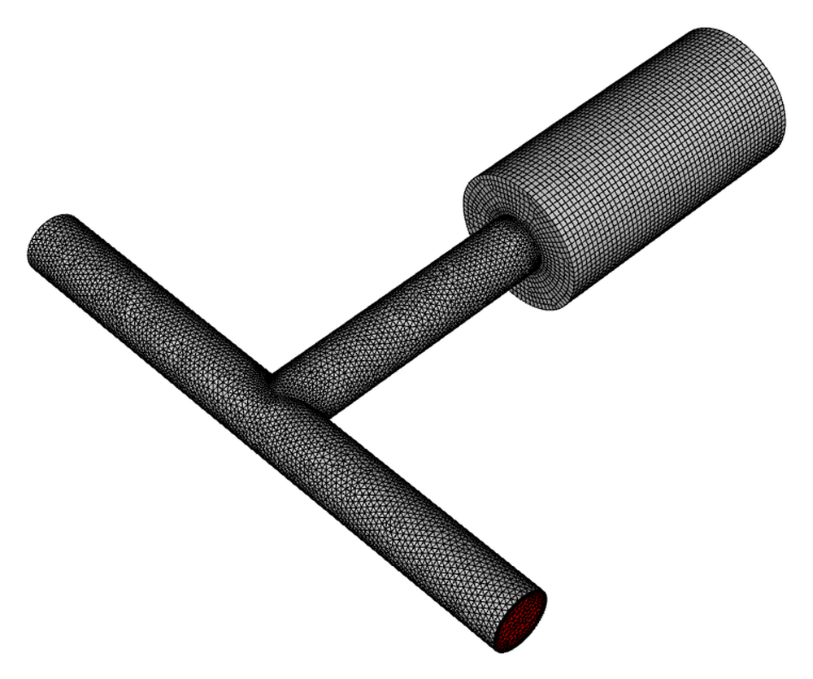
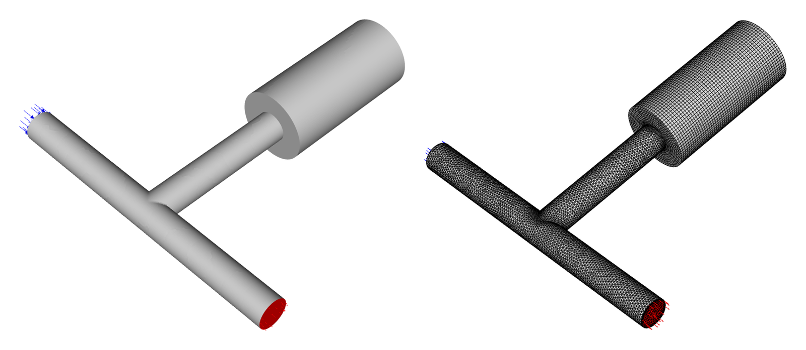
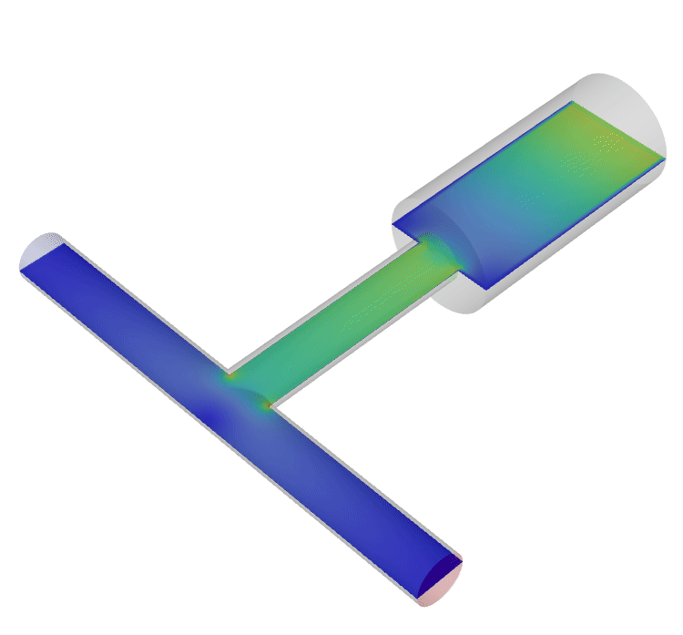
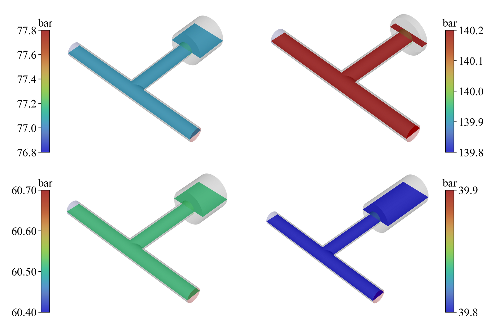
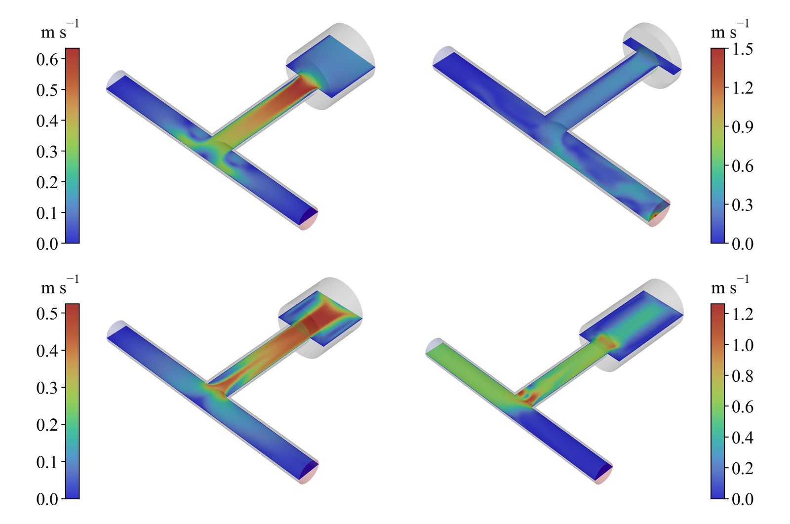

# Reciprocating compressor CFD

Transient 3-D CFD of the first-stage cylinder of a high-pressure reciprocating nitrogen booster,
run as a single stage from 40 to 140 bar at 75 rpm. This is the numerical part of my MSc thesis at
the Middle East Technical University (2026), done in collaboration with Logos Kimya, whose YB690
booster is the machine studied.

## Introduction

https://github.com/user-attachments/assets/8161fb83-d31f-487a-8c43-41e7d62bef4b

<em>One compression cycle: the dynamic mesh, then pressure and velocity on the cut plane.</em>

## The problem

Spring-loaded ball check valves on the suction and discharge ports open and close on the pressure
difference across them. At these pressures the gas is far from ideal, heat exchange with the
cylinder wall matters, and the delivered flow depends on how the valves move. The CFD resolves the
in-cylinder flow and pressure fields that a 0-D model can only average.

## What the model does

- Dynamic mesh that follows the piston motion through the full cycle.
- Transient pressure-based PISO solver in ANSYS Fluent, with k-omega SST turbulence.
- Peng-Robinson real-gas nitrogen.
- Check-valve dynamics and wall heat transfer coupled through C user-defined functions.
- Validation by the cycle-averaged inlet-versus-outlet mass balance, with the P-V diagram
  cross-checked against the 0-D model.

  
   <em>The dynamic mesh over one crank revolution, following the piston.</em>

  
   <em>Computational domain and mesh.</em>

## Flow fields

  
   <em>Velocity magnitude on the cut plane over one crank revolution (blue low, red high).</em>

   
  
   <em>Pressure and velocity on the cut plane at selected crank angles.</em>

## Related pages

[Check valve CFD](https://github.com/astralisxx/check-valve-cfd) and
[Compressor heat transfer](https://github.com/astralisxx/compressor-heat-transfer) cover the valve
and the wall heat transfer in depth. The 0-D model also runs inside the
[LOGOS-YB690 Booster](https://github.com/astralisxx/logos-yb690-booster) desktop simulator.

## Related work

- A. B. Şimşek, B. Erdoğan, N. B. Üner, "Computational Design of a High-Pressure Compressor and Its
  Experimental Validation", ICCHMT 2025, Lecture Notes in Mechanical Engineering, Springer,
  pp. 390-399, 2026. https://doi.org/10.1007/978-3-032-16138-3_36 (the earlier 2-D CFD model).
- F. Turgut, A. B. Şimşek, N. B. Üner, B. Erdoğan, "Analysis of a High-Pressure Reciprocating
  Compressor Piston's 2D Simulation Utilizing Computational Fluid Dynamics", ICBASET 2024, The
  Eurasia Proceedings of Science, Technology, Engineering and Mathematics, vol. 28, pp. 352-359,
  2024. https://doi.org/10.55549/epstem.1523562
- MSc thesis: "Experimental and Numerical Design of a High-Pressure Reciprocating Compressor",
  METU, 2026.
- A journal manuscript on the 0-D and 3-D models is in preparation.

## Files

This repository holds only this page and its figures. The Fluent case, the user-defined functions
and the MATLAB models are private.

Copyright (c) 2026 Ahmet Berkay Şimşek. All rights reserved. The figures and animations may not be
reused without permission.
